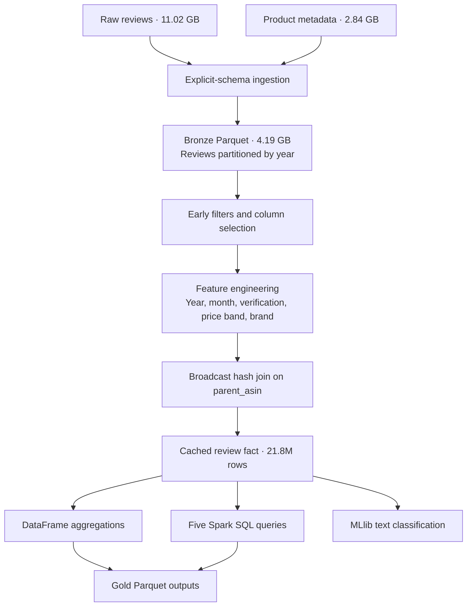
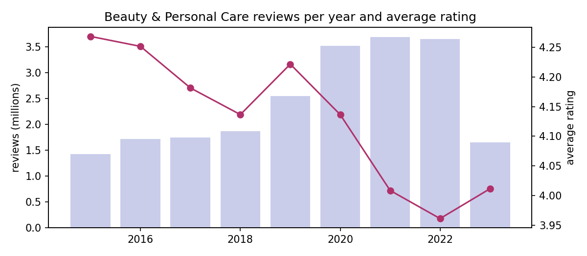
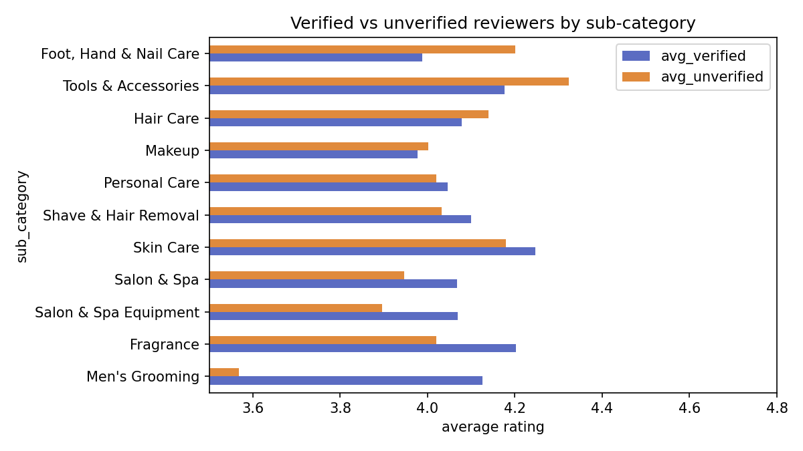
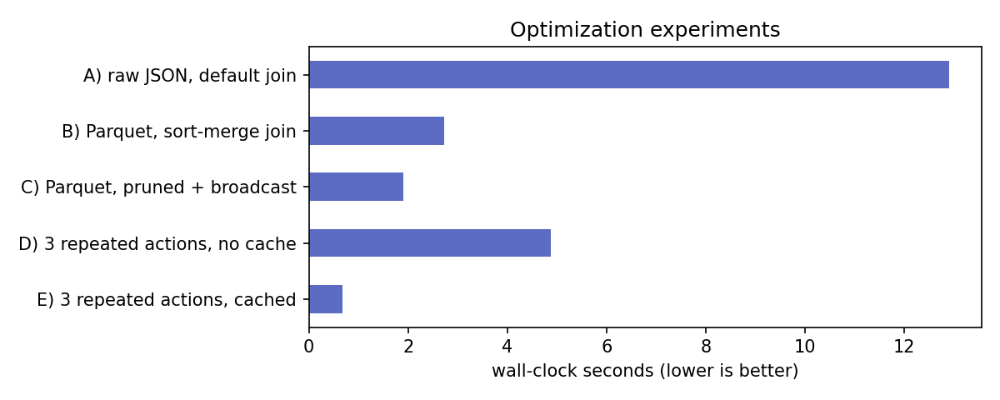
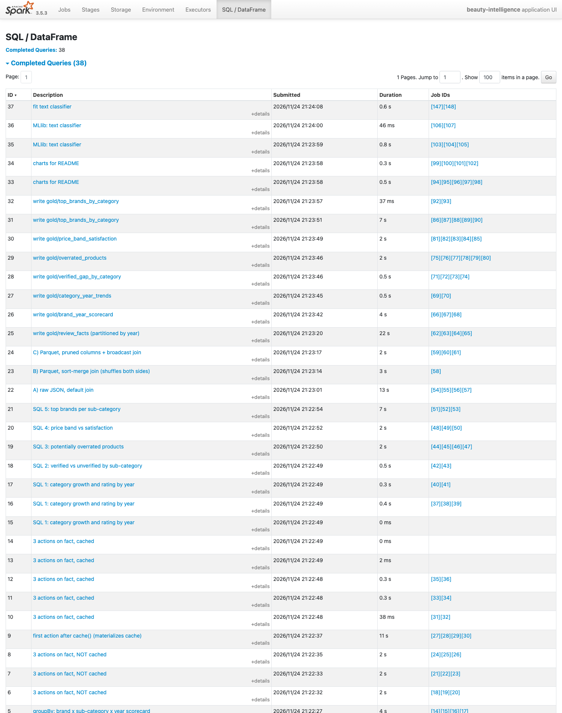
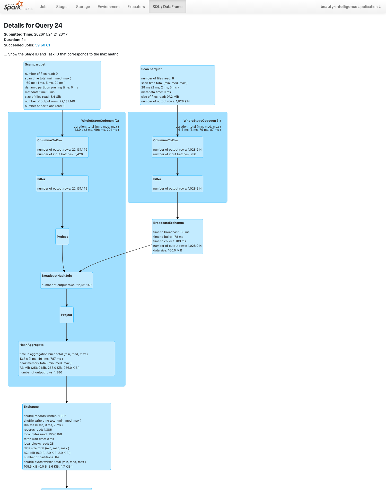

<p align="center">
  
</p>

# BeautyIQ

**Do expensive beauty products actually deliver better customer satisfaction?**

A PySpark data engineering project exploring Amazon Beauty & Personal Care reviews at scale, from raw JSON ingestion to optimized analytical queries and a text classification model.

`Python` · `PySpark 3.5.3` · `Spark SQL` · `Parquet` · `MLlib`

**Shahad Baalkhashir** | Duke University · IDS 706: Data Engineering Systems · Week 12

## Overview

I wanted to use this assignment to investigate a question I find interesting as a consumer: whether the price and popularity of beauty products reflect the experience of the people who buy them. I built a pipeline that combines product metadata with millions of customer reviews to examine category trends, rating differences, pricing and brand performance.

The engineering challenge was processing several gigabytes of data on a laptop while keeping repeated analytical queries efficient. Rather than working directly with raw JSON for every query, I converted the data to partitioned Parquet and experimented with column pruning, broadcast joins, adaptive query execution and caching. I used the Spark History Server to inspect the actual execution plans and query metrics.

| Input data | Reviews ingested | Products ingested | Joined review records |
|:---:|:---:|:---:|:---:|
| **13.86 GB** | **23,911,390** | **1,028,914** | **21,829,320** |

| Query speedup | Cached repeated actions | Parquet storage | Text classification AUC |
|:---:|:---:|:---:|:---:|
| **6.8×** | **7.3×** | **4.19 GB** | **0.967** |

<sub>All metrics refer to the recorded local run on the full dataset described below. Speedups are from the specific benchmark configurations, not general Spark performance guarantees.</sub>

[Dataset](#1-dataset) · [Architecture](#2-pipeline-architecture) · [Findings](#3-consumer-insights) · [Performance](#4-performance-analysis) · [Reproduce](#7-reproduce-the-project) · [Evidence](#8-execution-evidence)

## Deliverables

| File | Description |
|---|---|
| [Pipeline notebook](notebooks/beauty_pipeline.ipynb) | Complete PySpark processing, SQL analysis and experiments |
| [Executed notebook (HTML)](notebooks/beauty_pipeline.html) | Notebook with recorded outputs; download to view locally if needed |
| [Bronze ingestion script](scripts/01_bronze_ingest.py) | Explicit-schema JSONL ingestion and Parquet conversion |
| [Spark UI screenshots and charts](screenshots/) | Execution evidence, query details and analytical visualizations |
| `output/gold/` | Partitioned fact data and six analytical summary tables in Parquet |

---

## 1. Dataset

I used the **Amazon Reviews 2023 — Beauty and Personal Care** dataset from the McAuley Lab at UC San Diego. Product metadata and customer reviews are linked using `parent_asin`.

**Source:** [McAuley-Lab/Amazon-Reviews-2023](https://huggingface.co/datasets/McAuley-Lab/Amazon-Reviews-2023) (`raw/review_categories/` and `raw/meta_categories/`).

| Dataset | Raw data used | Records ingested | Relevant fields |
|---|---:|---|---|
| `Beauty_and_Personal_Care.jsonl` | 11.02 GB | 23,911,390 reviews from 11,325,787 reviewers | Rating, product ID, reviewer ID, timestamp, verification, helpful votes, text |
| `meta_Beauty_and_Personal_Care.jsonl` | 2.84 GB | 1,028,914 products | Product ID, title, category, price, store, brand, average rating |
| **Total** | **13.86 GB** | | |

The ingested Parquet datasets occupy **4.19 GB**, approximately 70% less storage than the raw input. This reduction reflects both Parquet compression and the removal of unused fields during ingestion.

> **Practical note.** My first download over a phone hotspot stalled at approximately 110 KB/s, so an early version of this project ran on only the first 4.53 GB of the review file. I later resumed the download on Wi-Fi and re-ran the entire pipeline on the **complete** review and product files. Every number in this README comes from that full-data run.
>
> The raw metadata also tags some products with promotional pseudo-categories (for example "National Lipstick Day" or "Customers' Most-Loved Beauty_Temp"). The pipeline keeps only Amazon's 11 standard Beauty & Personal Care departments, so category comparisons are like-for-like.

## 2. Pipeline architecture



### Processing stages

| Stage | Implementation | Design decision |
|---|---|---|
| Ingest | `spark.read.schema(...).json(...)` | Avoid schema inference and omit unused image/video fields |
| Store | `write.partitionBy("review_year").parquet(...)` | Enable year-based partition pruning |
| Filter | Reviews since 2015, non-null ratings and keys; products in the 11 standard beauty departments with at least five ratings | Reduce irrelevant rows before the join |
| Transform | `withColumn` for `review_month`, `is_verified`, `sentiment`, `price_band`, normalized `brand` and `review_year` | Derive consistent analytical dimensions |
| Join | Broadcast a slim product dimension on `parent_asin` | Avoid shuffling the large review side during the join |
| Aggregate | Brand × sub-category × year; `count`, `avg`, `sum`, `countDistinct` | Produce reusable scorecards |
| Query | Five Spark SQL queries on `beauty_reviews`, including CTEs, `CASE`, ranking windows and `PERCENTILE_APPROX` | Answer consumer questions |
| Persist | Partitioned `output/gold/review_facts` and six summary tables | Save analysis-ready outputs |

## 3. Consumer insights

### 01 — How have reviews and ratings changed over time?



Review volume rose from **1.42M in 2015 to 3.65M in 2022**, while the average rating declined from **4.27 to 3.96**. Hair Care had the most reviews (5.86M), followed by Skin Care (4.25M). Makeup had the lowest satisfaction among the large categories in 2022, averaging **3.82 stars with 24.2% negative reviews**. These trends could reflect changes in product mix, reviewer behavior or sample composition, rather than a decline in product quality alone.

### 02 — Do verified and unverified reviewers rate products differently?



The difference depends on the category. Unverified reviews were more positive in Foot, Hand & Nail Care (**+0.21 stars**) and Tools & Accessories (**+0.15**), but more negative in Fragrance (**−0.18**) and Men's Grooming (**−0.56**).

### 03 — Which products have unusually large rating gaps?

Among products with at least 30 reviews in each verification group, two examples stood out:

| Product | Verified | Unverified | Difference |
|---|:---:|:---:|:---:|
| Body glitter spray | 1.77 | 4.29 | **+2.52** |
| Nail polish set | 2.19 | 4.33 | **+2.13** |

Another glitter spray, a cellulite cream, precision tweezers and a lash-growth serum also appeared among the largest gaps. I use the term *potentially overrated* as an exploratory flag, not an accusation of fake reviews. Verification status does not establish reviewer honesty or explain the differences on its own.

### 04 — Are expensive beauty products worth it?

| Product price | Average rating | Negative reviews |
|---|:---:|:---:|
| Under $10 | 4.04 | 18.9% |
| $10 and above (range across bands) | 4.12–4.16 | 16.3–17.7% |

The main difference appeared between the lowest-priced products and the remaining price bands, after which ratings were relatively stable. Reviews of products over $50 received around **1.8 helpful votes per review** compared with **0.9** for products under $10. That is an engagement signal, not direct evidence of how closely customers read reviews.

The results suggest a modest association between listed price and satisfaction in this dataset. They do not show that paying more causes higher satisfaction. Metadata prices may differ from the prices customers originally paid.

### 05 — Which brands stand out within their categories?

Among brands meeting the 2,000-review threshold, examples of highly rated brand/category combinations included:

| Brand | Category | Average rating |
|---|---|:---:|
| Oberon Design | Hair care | 4.87 |
| Geopu | Foot care | 4.86 |
| Eight Saints | Skin care | 4.80 |
| Arishine | Makeup | 4.65 |
| Lancôme | Fragrance | 4.53 |

Several highly rated options were priced below $15. Brand ratings should be interpreted within categories and alongside review counts, rather than as a universal ranking of beauty brands.

## 4. Performance analysis

### What Catalyst optimized

The formatted physical plan showed three scan-level optimizations. Since reviews were partitioned by `review_year`, the year predicate appeared under `PartitionFilters` and only nine of the 24 year partitions were read. Null checks on `rating` and `parent_asin` appeared under `PushedFilters`, allowing the Parquet reader to skip eligible row groups where statistics permit. `ReadSchema` showed that only the columns required by the query were read, instead of scanning wide text fields unnecessarily. I also tested filters written after the join: Catalyst moved the year and price predicates down to the appropriate relations. Writing filters early makes the intent clear, but the optimized plan is the evidence of whether pushdown occurs.

```text
(1) Scan parquet
PartitionFilters: [isnotnull(review_year#9), (review_year#9 >= 2015)]
PushedFilters:    [IsNotNull(rating), IsNotNull(parent_asin)]
ReadSchema:       struct<rating:double,parent_asin:string,verified_purchase:boolean>
...
BroadcastHashJoin Inner BuildRight
```

### Bottlenecks and optimization decisions

JSON parsing and shuffle-heavy joins were the main bottlenecks in the benchmark. The forced sort-merge join shuffled 22.1M review rows (844 MiB) and sorted both inputs. Broadcasting a slim product dimension avoided the large review-side join shuffle, while deferring long product titles until the final result lookup reduced unnecessary broadcast data. I also added a broadcast hint to the small ranked result before its title lookup. The optimized Parquet/broadcast configuration ran in **1.90 seconds versus 12.91 seconds** for the raw JSON/default-join configuration. This is a combined optimization comparison, not an isolated measurement of any one technique. With 64 configured shuffle partitions, Adaptive Query Execution coalesced one observed shuffle to 11 partitions, reducing small-task overhead.

### Benchmark results and caching

The joined fact table feeds five SQL queries and seven writes, making reuse a natural reason to cache. Calling `.cache()` was lazy; the first action materialized the cache and took 11.33 seconds. Subsequent repeated actions read from `InMemoryTableScan` in the Spark UI and took **0.67 seconds in total instead of 4.88 seconds** without caching (**7.3× faster**). This improvement excludes initial materialization and is a warm-cache comparison; caching only pays off when enough work is reused. The measurements are wall-clock timings from a single recorded run, not averages over controlled repetitions.



| Experiment | Wall-clock time | Relative comparison |
|---|---:|---|
| A. Raw JSON, default join | 12.91 s | Baseline |
| B. Parquet, forced sort-merge join, AQE off | 2.72 s | 4.7× faster than A |
| C. Parquet, pruned columns + broadcast join | **1.90 s** | **6.8× faster than A** |
| D. Three repeated uncached actions | 4.88 s | Reuse baseline |
| E. Three repeated warm-cache actions | **0.67 s** | **7.3× faster than D** |

**Additional execution evidence:**

| Observation | Optimization | Evidence |
|---|---|---|
| Raw JSON scan: 10.3 GiB reviews + 2.6 GiB products; 1.4 minutes of aggregate task time in the review scan stage | One-time Parquet conversion | [Raw JSON plan](screenshots/06_query_details_raw_json.png) |
| Both sides shuffled and sorted for the join | Broadcast the product dimension | [Sort-merge](screenshots/05_query_details_sortmerge_join.png) / [broadcast](screenshots/04_query_details_broadcast_join.png) |
| Test broadcast with long titles: 33 MiB for 16.7k products; full slim dimension: 160 MiB | Exclude wide columns from the broadcast; retrieve titles for final results | [Broadcast plan](screenshots/04_query_details_broadcast_join.png) |
| Additional sort-merge join for title lookup | `/*+ BROADCAST(s) */` on the small result; `BroadcastHashJoin BuildLeft` | [SQL 3 plan](screenshots/03_query_details_overrated_sql3.png) |
| Repeated execution of joined fact | Cache and materialize once | [InMemoryTableScan](screenshots/07_query_details_cached_InMemoryTableScan.png) |

<sub>**Environment:** MacBook Air, 10 cores, 24 GB RAM; Spark 3.5.3 in `local[*]` mode, 12 GB driver memory, battery power. Local Spark demonstrates parallel partition processing and query optimization on one machine; these results do not establish multi-node cluster scaling. Task time aggregates executor work and is distinct from elapsed wall-clock time.</sub>

## 5. Actions vs. transformations

The notebook uses the Spark status tracker to demonstrate lazy evaluation rather than simply describing it.

```text
5 transformations built in 17.0 ms  -> jobs launched: 0
count() action took 0.74 s          -> jobs launched: 3
                                      result: 334,033 products
```

The `filter → filter → withColumn → select → groupBy` chain constructed a logical plan without launching a Spark job in this experiment. Calling `count()` triggered optimization and execution, launching three jobs. `.explain()` inspected the plan without materializing the DataFrame. Lazy evaluation gives Catalyst a view of the transformation chain before execution, enabling optimizations such as pruning and filter pushdown.

## 6. Optional extension: MLlib review classification

I also built a lightweight text classifier to connect the data engineering pipeline to an NLP task. The model predicts positive (4–5 stars) versus negative (1–2 stars) reviews using their text; neutral ratings are outside the binary task.


| Reported evaluation metric | Result |
|---|:---:|
| AUC | **0.967** |
| Accuracy | **92.8%** |

The model was trained on approximately 317k sampled reviews from 2022–2023. Strong negative words included *disappointed, waste, worst, horrible, useless,* and *scam*; positive words included *great, love, perfect, works, amazing,* and *easy*. These are reported results for the notebook's evaluation setup, not a guarantee of accuracy on unseen products or future reviews.

## 7. Reproduce the project

**Requirements:** Python, Java 17, PySpark 3.5.3 and sufficient disk space for raw data, intermediate Parquet, output files and Spark event logs. On macOS, Java 17 can be installed with `brew install openjdk@17`.

```bash
make setup      # Set up the virtual environment and dependencies
make download   # Download the full dataset (~14 GB)
make bronze     # Convert raw JSONL to Parquet
make run        # Execute notebook and export HTML
make history    # Replay the Spark event logs on localhost:18080
```

The notebook can be inspected without rerunning the pipeline using the [executed HTML export](notebooks/beauty_pipeline.html). After running `make history`, open Spark History Server locally to inspect recorded jobs, stages and SQL execution details. A full run needs roughly 14 GB for raw data, 4 GB for Parquet and 1 GB for outputs.

## 8. Execution evidence

The screenshots below are from the Spark History Server replay of the recorded notebook run. Full `.explain()` outputs (simple, formatted and extended) are available in notebook sections 2, 3, 5a and 5b.

**Successful pipeline execution**

[](screenshots/01_sql_queries_all_completed.png)

**Optimized broadcast join**

[](screenshots/04_query_details_broadcast_join.png)

| Evidence | What to inspect |
|---|---|
| [01 — SQL/DataFrame tab](screenshots/01_sql_queries_all_completed.png) | 38 completed queries, named with `setJobDescription` |
| [02 — Jobs tab](screenshots/02_jobs_all_succeeded.png) | Successful Spark jobs |
| [03 — SQL 3 Query Details](screenshots/03_query_details_overrated_sql3.png) | Cached scan, two-phase hash aggregation, AQE (64 → 11 partitions), ranking and broadcast title lookup |
| [04 — Optimized broadcast join](screenshots/04_query_details_broadcast_join.png) | Nine partitions read, 160 MiB broadcast, no review-side join shuffle |
| [05 — Sort-merge join](screenshots/05_query_details_sortmerge_join.png) | `Exchange` and `Sort` on both inputs |
| [06 — Raw JSON baseline](screenshots/06_query_details_raw_json.png) | Input scan volumes and shuffle |
| [07 — Cached scan](screenshots/07_query_details_cached_InMemoryTableScan.png) | `InMemoryTableScan` |
| [08 — Stages tab](screenshots/08_stages.png) | Tasks, input size and shuffle read/write |

## 9. Assignment coverage

| Requirement | Implementation |
|---|---|
| Dataset ≥1 GB | 13.86 GB raw input; 4.19 GB after ingestion |
| Transformations | Multiple filters, broadcast join, `groupBy`, aggregations and `withColumn` |
| At least two SQL queries | Five analytical Spark SQL queries |
| Optimization | Early filtering, partition/predicate/column pruning, broadcast join, AQE |
| Output writing | Partitioned fact table and six Parquet summary tables |
| Execution plans and screenshots | Notebook `.explain()` outputs and Spark History Server evidence |
| Performance analysis | Section 4, including measured baseline and optimized runtimes |
| Actions vs. transformations | Status-tracker experiment with zero vs. three launched jobs |
| Bonus caching | Warm-cache repeated-action benchmark |
| Optional MLlib | TF-IDF and logistic regression text classification |

## Repository structure

```text
beautyiq-pyspark/
├── README.md
├── Makefile
├── requirements.txt
├── scripts/
│   └── 01_bronze_ingest.py
├── notebooks/
│   ├── beauty_pipeline.ipynb
│   └── beauty_pipeline.html
├── output/gold/                  # Analytical Parquet tables
├── screenshots/                  # Spark UI, analytical charts and banner
└── data/                         # Raw and bronze files (git-ignored)
```

The large `output/gold/review_facts` dataset (988 MB in the recorded run) is also git-ignored.

## References

- Hou et al. (2024). *Bridging Language and Items for Retrieval and Recommendation.* Amazon Reviews 2023 dataset.
- [Apache Spark documentation](https://spark.apache.org/docs/3.5.3/).

---

<sub>Academic project · Duke University · Fall 2026. Header artwork is illustrative, not a visualization of measured results.</sub>
